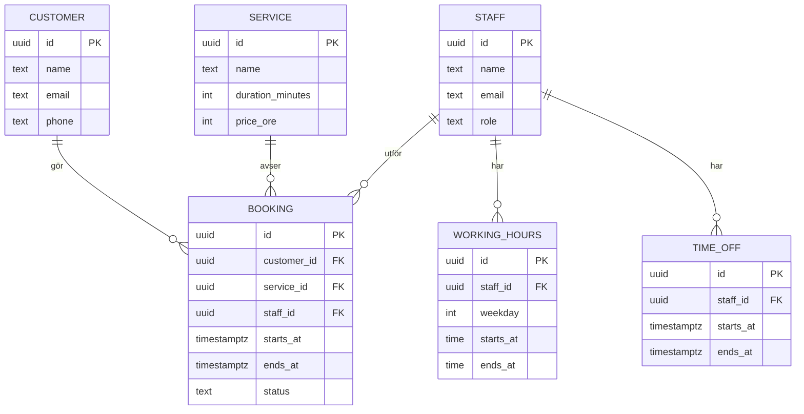

# ERC

Ett boknings- och kundhanteringssystem för små tjänsteföretag, till exempel en frisörsalong eller en verkstad. Kunder bokar tider online, och personalen hanterar bokningar, kunder och scheman på ett ställe.

Projektet är ett portfolioprojekt med fokus på det som är svårt i riktiga system: datamodellering, samtidighet, behörigheter, tester och driftsättning.

> **Status:** Planering. Ingen kod är skriven än. Planen nedan uppdateras under projektets gång.

## Mål

- Bygga ett litet system som fungerar från början till slut och går att testa via en publik demo.
- Garantera på databasnivå att en tid inte kan dubbelbokas.
- Dokumentera tekniska val och motivera dem, så att det går att följa hur jag resonerat.

**Utanför första versionen:** onlinebetalning, flera företag i samma installation (multi-tenancy), mobilapp och kalendersynk.

## Funktioner

### MVP

- Visa tjänster och lediga tider
- Boka och avboka en tid som kund
- Inloggning för personal och administratörer
- Hantera bokningar, kunder, tjänster och arbetstider
- Bekräftelse via e-post

### Senare

- Påminnelser före bokad tid
- Kundhistorik och anteckningar
- Statistik över beläggning och populära tjänster
- Kalendersynk via iCal
- Kortbetalning vid bokning

## Research

Varje fråga avslutas med ett kort beslut i `docs/decisions/`.

| Område | Fråga | Utgångspunkt |
| --- | --- | --- |
| Liknande system | Hur fungerar flödena i Calendly, Cal.com och Bokadirekt? | Lista vad som ska efterliknas och vad som kan väljas bort |
| Dubbelbokning | Hur stoppas krockar när två personer bokar samtidigt? | PostgreSQL-constraint med `EXCLUDE` på tidsintervall |
| Tid och datum | Hur hanteras tidszoner och sommartid? | Lagra i UTC, visa i företagets tidszon |
| Tillgänglighet | Hur räknas lediga tider ut från arbetstider, frånvaro och bokningar? | Beräkna vid förfrågan, ingen lagring av färdiga tidsluckor |
| Inloggning | Sessioner eller JWT, eget eller färdigt bibliotek? | Sessionscookies med ett beprövat bibliotek |
| Personuppgifter | Vad kräver GDPR för kunddata? | Samla in minimalt, stöd för export och radering |
| Driftsättning | Var kan demon köras billigt? | Jämför Fly.io, Railway och Render |

## Teknik

Preliminärt val, som bekräftas eller ändras under researchen.

| Del | Val | Motivering |
| --- | --- | --- |
| Språk | TypeScript | Samma språk och delade typer i frontend och backend |
| Backend | Node.js med Fastify | Litet ramverk med inbyggd schemavalidering |
| Databas | PostgreSQL | Transaktioner och stöd för constraints på tidsintervall |
| Frontend | React med Vite | Stort ekosystem och enkel uppsättning |
| Tester | Vitest och Playwright | Enhets- och integrationstester samt tester av hela flöden |
| Drift | Docker och GitHub Actions | Samma miljö lokalt och i CI |

## Datamodell

Första utkastet:



Dubbelbokningar stoppas av databasen, även om två förfrågningar kommer in samtidigt:

```sql
CREATE EXTENSION IF NOT EXISTS btree_gist;

ALTER TABLE booking ADD CONSTRAINT no_overlapping_bookings
  EXCLUDE USING gist (
    staff_id WITH =,
    tstzrange(starts_at, ends_at) WITH &&
  ) WHERE (status <> 'cancelled');
```

## Plan

### Fas 0: Research och design

- [ ] Gå igenom researchfrågorna och skriv ner besluten
- [ ] Fastställ MVP och datamodell
- [ ] Skissa de viktigaste vyerna
- [ ] Skriv en första API-specifikation

**Klart när:** alla preliminära val är bekräftade eller ändrade.

### Fas 1: Projektgrund

- [ ] Sätt upp backend, frontend och PostgreSQL med Docker Compose
- [ ] Lägg till migreringar och testdata
- [ ] Sätt upp linting, tester och CI i GitHub Actions

**Klart när:** projektet startar med ett kommando och CI körs på varje pull request.

### Fas 2: Bokningskärnan

- [ ] Skapa tabeller och constraint för bokningar
- [ ] Bygg API för tjänster och bokningar
- [ ] Beräkna lediga tider
- [ ] Testa samtidiga bokningar, sommartid och avbokning

**Klart när:** ett test med parallella bokningar av samma tid ger exakt en lyckad bokning.

### Fas 3: Inloggning och administration

- [ ] Lägg till inloggning och roller
- [ ] Bygg API för kunder, personal och arbetstider

**Klart när:** tester visar att varje roll bara kommer åt det den ska.

### Fas 4: Gränssnitt

- [ ] Bygg bokningsflödet för kunder
- [ ] Bygg kalender och administrationsvyer för personal
- [ ] Säkerställ att sidorna fungerar på mobil och med tangentbord
- [ ] Skriv Playwright-tester för de viktigaste flödena

**Klart när:** det går att genomföra en bokning från början till slut i webbläsaren.

### Fas 5: Lansering

- [ ] Skicka bekräftelser via e-post
- [ ] Lägg till loggning, felhantering och rate limiting
- [ ] Driftsätt en demo med påhittad testdata
- [ ] Färdigställ README med skärmbilder, arkitekturbild och instruktioner

**Klart när:** demon är publik och går att prova utan installation.

## Licens

MIT (läggs till när koden påbörjas).
