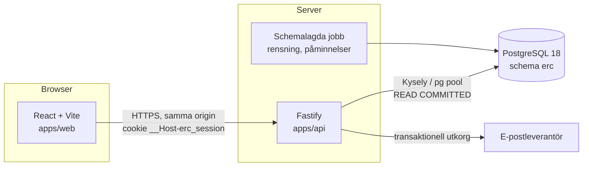

# Arkitektur

## Översikt



- **Samma origin:** i produktion serverar API:t den byggda webben (eller en proxy framför båda). Det gör att CORS inte behövs och att `SameSite=Lax` tillsammans med kontroll av `Origin` räcker som CSRF-skydd (ADR-0008).
- **E-post via utkorg** (Fas 5): bokningen och en rad i `outbox` skrivs i samma transaktion, och ett jobb skickar mejlen. En bekräftelse skickas därför aldrig för en bokning som rullades tillbaka, och mejl går inte förlorade om leverantören är nere.

## Mappstruktur

```
.
├── apps/
│   ├── api/                      Fastify-backend
│   │   ├── db/
│   │   │   ├── migrations/       NNNN_namn.sql, går bara framåt (ADR-0006)
│   │   │   └── seed/             påhittad demo- och testdata
│   │   ├── src/
│   │   │   ├── app.ts            buildApp(deps): Fastify utan listen, för tester
│   │   │   ├── server.ts         processens startpunkt
│   │   │   ├── config.ts         miljövariabler, validerade med TypeBox vid start
│   │   │   ├── db/               pool, Kysely-instans, genererade typer, transaktioner
│   │   │   ├── http/             felhanterare (RFC 9457), auth-hooks, CSRF, rate limit
│   │   │   ├── shared/           Clock, id, kryptohjälpare, Result-typer
│   │   │   └── modules/
│   │   │       ├── availability/ slots.ts (ren funktion), repository, routes
│   │   │       ├── bookings/     routes → service → repository
│   │   │       ├── services/
│   │   │       ├── staff/        personal, arbetstider, frånvaro
│   │   │       ├── customers/
│   │   │       └── auth/         sessioner, inloggning, e-postlänkar
│   │   └── test/
│   │       ├── setup/            testdatabas (Testcontainers eller TEST_DATABASE_URL)
│   │       ├── db/               constraints och triggers direkt i SQL
│   │       └── integration/      HTTP-nivå, behörighet, samtidighet
│   └── web/                      React + Vite
│       └── src/
│           ├── routes/           kundflöde, personalvyer
│           ├── features/
│           └── lib/              API-klient (typad från contracts), datum och tid
├── packages/
│   └── contracts/                TypeBox-scheman och typer som API och webb delar
├── e2e/                          Playwright
├── docs/
│   ├── architecture.md
│   ├── decisions/                ADR:er
│   ├── database/                 datamodell och schemautkast
│   ├── api/                      API-specifikation, senare även genererad openapi.json
│   └── ux/                       vyskisser
├── compose.yaml                  PostgreSQL 18 (+ api och web i Fas 1)
└── .github/workflows/            CI
```

### Lager i backend

Varje modul har tre lager, och beroenden pekar bara inåt:

| Lager | Ansvar | Får inte |
| --- | --- | --- |
| `routes.ts` | Scheman, behörighet (`preHandler`), översätta HTTP till anrop | innehålla affärslogik eller SQL |
| `service.ts` | Användningsfall, policy, transaktionsgränser, ägarskapskontroll | känna till HTTP |
| `repository.ts` | SQL via Kysely, tar emot `Kysely` eller `Transaction` | fatta affärsbeslut |

Rena funktioner som tidsluckor och tidsrutnät har inga beroenden alls och testas med egenskapstester.

## Konfiguration

All konfiguration kommer från miljövariabler och valideras vid start. Processen avslutas med ett tydligt fel om något saknas. Hemligheter loggas aldrig.

| Variabel | Exempel |
| --- | --- |
| `DATABASE_URL` | `postgres://erc_app:…@localhost:5432/erc` |
| `PUBLIC_ORIGIN` | `https://erc.example` (används för Origin-kontroll och länkar) |
| `NODE_ENV` | `production` |
| `LOG_LEVEL` | `info` |
