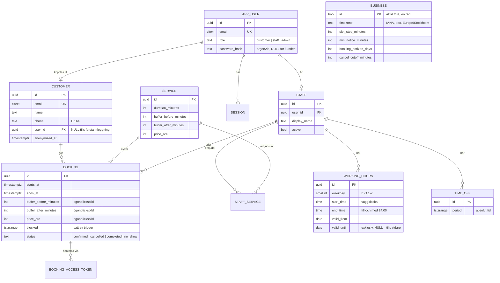

# Datamodell

Schemat finns i migreringen [`0001_initial.sql`](../../apps/api/db/migrations/0001_initial.sql). Motiveringarna finns i ADR-0002 till ADR-0005. Kysely-typerna i `apps/api/src/db/types.ts` genereras från den migrerade databasen, och CI kontrollerar att de är aktuella.

## Ändringar jämfört med README:ns första utkast

| Ändring | Varför |
| --- | --- |
| `booking.blocked` inklusive buffert, och constraint på `blocked` | Buffert måste skyddas mot dubbelbokning, inte bara själva tjänstetiden |
| Ögonblicksbild av buffert och pris på bokningen | Ändringar av tjänsten ska inte skriva om historiken |
| `contact_name` och `contact_phone` på bokningen | En bokning utan konto får inte skriva över kunduppgifter (ADR-0008) |
| `staff_service` | Alla i personalen utför inte alla tjänster |
| `working_hours.valid_from/valid_until` och constraint mot överlappning | Schemaändringar gäller från ett visst datum, och överlappande pass ger fel |
| `time_off.period` som `tstzrange` | Intervallet är en egen typ med kontrollerade gränser, och det finns ett GiST-index |
| `staff.role` flyttat till `app_user.role` | Roll hör till inloggningen. En admin kan också vara personal. |
| `business` | Tidszon och bokningspolicy behöver lagras någonstans |
| `uuidv7()` i stället för slumpade UUID | Id:n sorteras efter tid, vilket ger bättre lokalitet i B-tree-index |

## Integritetsregler i databasen

| Regel | Mekanism | Fel |
| --- | --- | --- |
| Ingen överlappning per personal, inklusive buffert | `booking_no_overlap` (EXCLUDE, partiell) | `23P01` → 409 `slot-unavailable` |
| Aktiv bokning inom öppen tid (arbetstid − frånvaro) | trigger `booking_20_check_invariants` | `23514 booking_within_open_hours` → 409 `outside-open-hours` |
| Personalen utför tjänsten | samma trigger | `23514 booking_staff_performs_service` → 422 |
| Personalen är aktiv | samma trigger | `23514 booking_staff_active` → 409 |
| `blocked` kan inte förfalskas | trigger `booking_10_set_blocked` räknar alltid om | – |
| Inga överlappande arbetspass | `working_hours_no_overlap` | `23P01` → 409 `schedule-overlap` |
| Avbokning har tidsstämpel | `booking_cancellation_consistent` | `23514` → 500 (programmeringsfel) |

## Tester av schemat

I Fas 0 validerades utkastet mot PGlite (PostgreSQL i WASM). Kontrollerna finns nu som integrationstester i [`apps/api/test/db/schema.test.ts`](../../apps/api/test/db/schema.test.ts) och körs mot PostgreSQL 18 i CI:

- **Sommartid:** passet 01–05 lokal tid ger 3 verkliga timmar 2026-03-29 och 5 timmar 2026-10-25. 09:00 lokal tid blir 08:00Z före och 07:00Z efter omställningen. Resultatet är oberoende av sessionens `TimeZone`, och `end_time = '24:00'` fungerar.
- **Bokningar:** överlappning ger `23P01`. Start inom föregående buffert nekas, start exakt när bufferten slutar godkänns. Bokningar utanför arbetstid, över lunch, med buffert efter stängning eller med en tjänst personalen inte utför nekas. `blocked` går inte att skriva över.
- **Avbokning:** frigör tiden direkt. Att återaktivera en avbokad bokning på en tid som redan är tagen nekas.
- **Frånvaro:** nya bokningar under frånvaro nekas, medan befintliga bokningar och statusbyten påverkas inte.
- **Arbetstider:** överlappande pass nekas. Datumstyrd ändring av ett pass fungerar.

Valideringen i Fas 0 hittade en bugg i utkastet: BEFORE-triggers körs i bokstavsordning, så kontrollen kördes före omräkningen av `blocked`. Det är rättat genom att triggerna numreras.
